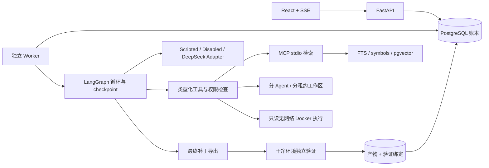

# 架构与恢复语义

RepairLab 面向代码工单，不包含服务恢复、运行日志/指标/trace 诊断或故障演练。下面的恢复机制处理平台自身的 worker、模型请求和工具中断。

## 数据与执行边界

PostgreSQL 保存项目、不可变工单契约、Run、Agent 委托、模型调用预占、ToolReceipt、Artifact、事件、验证、经验、Skills、实验与总预算池。LangGraph checkpoint 保存图循环进度。文件产物按 SHA256 寻址，写入使用临时文件、fsync 与原子替换；数据库提交前崩溃可能产生无引用文件，不会产生成功记录。

项目登记从本地 Git 对象读取指定 commit，排除 symlink、秘密及控制目录；不把工作树中未提交的变动带入快照。非 Git 目录只允许 `fixture-v1` 开发夹具。文档检索返回项目、commit、来源路径、行号和文档版本；创建工单时冻结已有公开材料的内容与哈希。

## 两套持久状态的职责

每轮先从账本读已确认 cursor 和 pending reply。调用模型前记录调用意图与费用预占；收到响应后，将 reply 与 usage 在同一事务落库。执行工具前先提交稳定 ID 对应的意图。完成工具后，保存产物并落库结果，然后推进 cursor。LangGraph 在节点边界保存 checkpoint。

恢复从账本最近确认的动作开始核查，并重新调用同一个图线程；不会把 checkpoint 中的“正在执行”当成副作用已经完成。图状态落后于账本时，稳定工具 ID 防止重复确认。真实模型请求已经预占但未保存响应时，进入 `waiting_input / uncertain_model_call`，保留预占，不自动重放可能已收费的请求。

## 租约、写入和迟到结果

领取使用 `SELECT ... FOR UPDATE SKIP LOCKED`，每次接管递增 epoch。心跳续租。提交结果、修改文件和终止运行都需要匹配 owner、epoch 和未过期租约。

工作区按 `run / agent / lease-epoch` 分代。新执行者从不可变快照和已确认写入记录重建新工作区。旧进程即使失去数据库连接后继续运行，也只能访问旧代文件。调查和实现子任务各有独立工作区；测试容器只读挂载工作区。

文件写入意图记录 before/after 哈希。恢复核查当前文件和上一代结果：已达预期状态时确认；仍处于 before 时应用声明式写入；冲突时失败并保留证据。集成多个文件时逐项进行同样的核查。工作区丢失后，可从已确认 receipt 的内容和集成清单重建。

测试通过动作 ID 命名容器。未确认结果先 inspect：已退出时读取退出码和日志，仍运行时等待/取消。只读测试的容器丢失时允许在隔离环境重新执行；它不具备宿主写入或外部业务副作用权限。旧租约返回不能向账本确认结果。

## 协作

主管默认自行工作。`single` 禁止委派；`parallel` 允许独立代码调查和复现，子任务不能写代码；`fixed` 按冻结的调查、复现、实现、集成计划推进；`adaptive` 接受基于 issue、公开产物或已验收子任务的结构化请求。

委托固定 key、角色、目标、scope、交付种类、假设与证据。最多两个并发、四个不同 key。子任务只修改自身允许的工作区；主管的 `integrate` 只能接受已验收实现子任务的实际补丁，并检查基线哈希与修改范围。父级从数据库和内容存储读取真实产物，不接受子 Agent 自报的任意 artifact ID。

代码调查必须有源码读取记录，复现必须有测试执行记录，实现必须有写入、公开测试及非空补丁。公开测试失败可以证明复现，不直接说明修复成立。最终是否修复由独立验证决定。

## 成功与控制

状态为 `queued/running/waiting_input/paused/verifying/succeeded/failed/cancelled`。终止原因另存。失败重试创建新 Run，并保留 retry_of。暂停在安全执行点生效，当前只读工具可先完成；取消停止新动作并回收正在执行的测试容器。父子共享 wall-clock deadline，暂停时间也计入总期限。

成功要求非空且范围合法的补丁、没有未解决工具错误或拒绝委托，以及匹配当前 patch/snapshot/image/verifier 哈希的独立通过结果。评分同时运行公开回归和隐藏测试。验证器只在 Agent 执行结束后进入新的评分副本。验证日志对用户可见，对 Agent 的 artifact 工具不可见。

## 预算与模型禁用

模型调用开关来自服务器环境，不存在修改该开关的 HTTP 接口。submit、实验、Adapter 和 embedding 均执行检查；关闭时即使有 API Key 也不会发请求。启动脚本默认关闭，只有显式真实模式参数才启用；前端只能选择服务器已允许的来源。

真实调用需要已配置价格快照；按输入 UTF-8 字节保守估算输入 token 上界，并预留最大输出 4096 token 的费用。父子和辅助步骤共用 Run 计数；全局预算行锁串行化总额预占，最高 2000 元。usage 缺失时保留预占。脚本化调用费用严格为 0，仍计入循环调用上限。没有模型压缩、Judge 或隐藏后台模型调用。

## 安全边界和适用范围

文件工具拒绝绝对路径、上跳、Windows 路径、symlink、控制目录和常见秘密文件。公开测试命令固定为 pytest 参数列表，没有任意宿主 shell。Docker 无网络、无 socket/密钥挂载、非 root、只读根和只读代码卷、1 CPU、512 MiB、128 PID、日志上限及独立 tmpfs。

代码文本、工具内容、issue 和经验作为不可信数据进入上下文，不能改变工具权限。经验的来源产物、项目、版本、回归结果和失效状态会被检查；候选经验不复用，参考补丁和隐藏验证不进入索引。通用经验/Skill 文本的语义审核仍需人工复核；字符串过滤不能证明任意文字都没有答案泄漏。

这是本地单用户系统。API 使用 bearer token、限定 CORS 并绑定 loopback；没有实现多租户、远程公开部署或对 Docker 内核漏洞的抵御。这些能力不计入当前交付。
