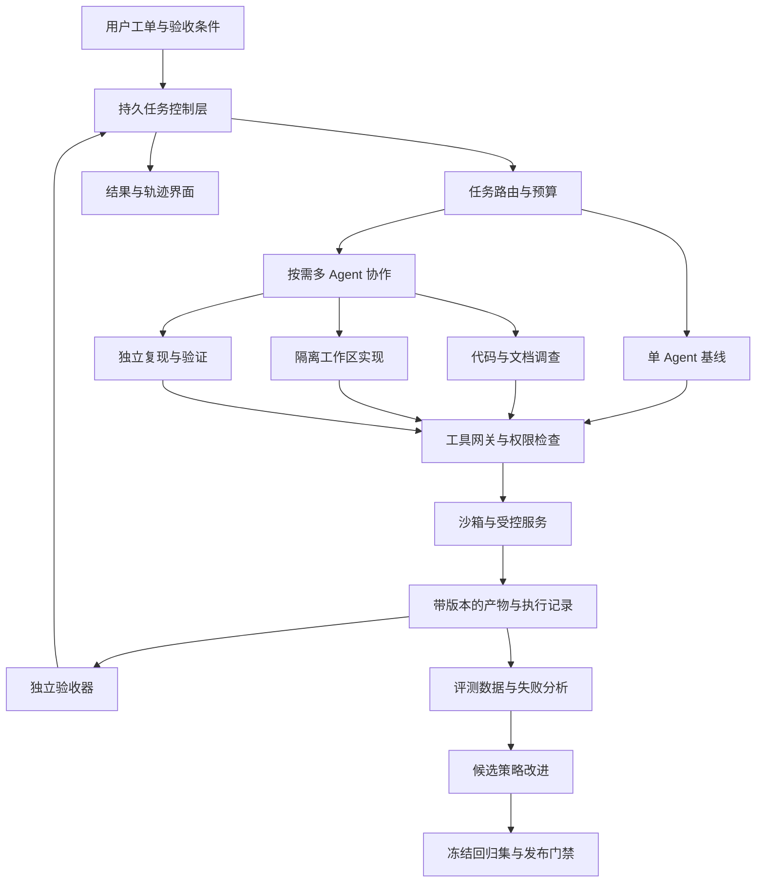

# 项目选题、能力映射与实施建议

基准日：2026-10-31。以下为广泛搜集后的研究判断和拟议设计，**没有实现、运行或测得文中的项目效果**。证据底表见[国内 JD](01-china-jd.md)、[海外 JD](02-global-jd.md)、[开源生态](03-oss-landscape.md)、[技术与论文](04-frontier-and-harness.md)。

## 结论与覆盖边界

建议做一个 **面向研发工单与故障排查的多 Agent 执行平台，配套可恢复 harness 和独立评测闭环**。用真实仓库、文档、工单和受控故障环境完成：理解问题 → 查代码/文档/日志 → 复现 → 给出修复补丁或诊断产物 → 独立验证 → 交付可审查证据。

默认目标是 Agent 应用研发、Agent 平台/harness 和评测工程岗位的共同技术能力；同一项目再加一条训练、安全或性能专长。它能支持作品集论证，不能直接满足工作年限、论文、学历、领域资质或超大规模训练经验。

依据是多个独立厂商的具体职责组合，而非关键词热度。例如[百度实习 J106681](https://talent.baidu.com/jobs/detail/INTERN/162291c8-43e8-4cc0-9c96-3fb0a7ebb720)将执行、skills、评测、trace 和成本连接在一起；[京东 Agent 架构开发](https://zhaopin.jd.com/web/job-info-detail?requementId=220462)明确中断恢复、并发与状态；[Anthropic Managed Agents](https://job-boards.greenhouse.io/anthropic/jobs/5395767008)强调持久执行、模型演进后的重新评测和稳定接口。

本轮有 60 条官方具体岗位材料：国内 28 条，海外 32 条；共 26 条正文实读、34 条官方索引证据。仅 22 家公司有这类材料，检索过但只读到入口/转载的公司另外保留。不能写成“60个当前在招岗位”“全大厂覆盖”或“覆盖率90%”。

## 1. 比较过的六类方向

评价尺度：岗位能力广度、可确定性验收、多 Agent 的必要性、harness 深度、个人可完成性和模型演进后的持续价值。以下高/中/低是研究者相对判断，不是量化实验分数。

| 候选方向 | JD 技术覆盖潜力 | 验收难度 | 多 Agent / harness 深挖空间 | 主要限制 | 取舍 |
|---|---|---|---|---|---|
| 证据型研究助手 | 中高：检索、引用、context、并行研究 | 高，开放问题很难唯一判定 | 高，广度检索适合并行 | 只输出报告时，副作用、事务恢复和执行能力展示较弱；与成熟 deep research 产品重叠 | 可做项目中的研究模块，或作为替代业务场景 |
| 企业客服/采购/业务工单 Agent | 高：RAG、工具、政策、状态、权限、评测 | 中，数据库终态可核查 | 高，跨角色交接与事务一致性有深度 | 真实业务数据、规则与用户获取成本；不能只编造成功案例 | 若已有企业数据或更偏应用岗，这是强替代选项 |
| 研发工单/故障排查与维护 Agent | 高：代码文档检索、规划、工具、协作、执行、验证、恢复 | 中，复现/测试/补丁可检查 | 高，独立调查、实现、QA 与运行平台都有实验空间 | coding agent 竞争拥挤；必须选窄任务并做可靠性差异 | **首选主场景** |
| 通用 Agent 评测/运行平台 | 平台/评测高，业务应用中 | 中 | 很高 | 只做基础设施界面，缺少真实任务和改进收益证明 | 与主场景合并为底座，避免单独空平台 |
| 万能个人助理/Agent OS | 名义覆盖很广 | 很高 | 高 | 范围失控、环境不稳定、集成与权限成本大；难有可信完成标准 | 不作为首版 |
| 大规模 Agent RL 系统 | 算法/训练高，应用/产品中 | 高 | 很高 | 算力、环境和奖励工程占比大，个人完成风险高 | 作为有预算的专长扩展 |

选择研发维护并不表示所有 JD 都在招聘 coding agent。选择理由是：它能以公开材料和可执行结果，集中证明可迁移的 Agent 工程能力。若未来明确只投客服/电商/商业化岗位，保留相同 harness，把任务环境换成政策约束的业务工单；[τ-bench 2.0](https://github.com/sierra-research/tau2-bench/releases/tag/v2.0.0)可作为设计参照。

## 2. 用户能得到什么

示例输入：“服务升级后某类订单请求出现 5xx。这里是仓库、工单、日志和运行说明，请定位原因，提供最小修复和验证记录。”

一次运行交付：

- 根因说明：引用代码 commit+行/符号、日志事件、文档版本；无法确认时标明缺失证据。
- 复现脚本或最小失败用例；失败前后结果可检查。
- 独立工作区中的补丁、差异摘要、回归结果和未解决问题。
- 任务执行时间线：谁做了什么、调用什么工具、耗费多少、在哪里失败及恢复。
- 结构化最终状态：已验证完成、部分交付、需要输入、失败或已取消；不会把“预算用完”自动记成成功。

建议首版只覆盖一种语言生态、少数仓库、几类明确问题，如依赖升级回归、接口行为错误、异步任务重复执行。UI 支持提交、观察、暂停/恢复、查看证据和比较实验；无需先做通用 IDE。

## 3. 架构：业务、控制和执行分层

### 任务与状态

每个任务有：目标、成功条件、允许资源、输入快照、依赖、总预算、deadline、取消状态、产物与验收结果。运行状态建议包括 pending/running/waiting/retrying/verifying/succeeded/failed/cancelled；子任务的终态与父任务终态分别计算。

模型对话、持久任务账本和沙箱文件是三种状态，分开存储与恢复。使用追加事件与快照恢复已确认步骤；对重试、迟到结果、worker lease 过期、重复投递和取消竞争做显式处理。恢复时先对账不确定的工具动作，不能一律重跑。

工具调用至少记录 input schema、scope、版本、错误类型、超时、结果、产物 hash、可重试性与副作用类别。涉及业务状态的工具使用幂等键、结果查询/对账或补偿；无法由本地 checkpoint 保证第三方副作用 exactly-once，应明确实际承诺。

### 多 Agent 协作

起步是 supervisor-worker，最多并行 2—3 个有清晰契约的 worker。调查代码、查文档和设计复现可以并行；修改共享代码时使用独立 worktree/分支，由单一集成步骤组合与验证。

委托包含 task ID、输入和范围、预期产物、验收器、预算与截止时间。工作者返回文件/补丁/测试记录及证据句柄；父控制层独立检查，不把 LLM 报告当作执行凭证。可以借鉴 [DeerFlow 2.1 的可验证交付设计](https://github.com/bytedance/deer-flow/releases/tag/v2.1.0)，但复用和自研部分必须分别注明。

引入自适应委托作为一项实验：简单任务单 Agent，独立证据来源多或需隔离上下文时才分工。任务路由可先写确定性规则，积累数据后再比较模型路由；不是任何一步都必须调用另一个 LLM。

### 上下文、检索和记忆

代码符号/文本检索、文档 BM25+向量混合检索、重排与来源定位构成基线；只有评测发现额外收益才加入图。检索必须按用户/项目 scope 过滤，并保留 commit、文档有效期和引用位置。

任务上下文在模型预算内组装，长工具输出保存为产物，模型按需读取片段。压缩时保留任务目标、重要约束、未验证假设和证据句柄，不能把“推测”压缩为“已证实”。

长期经验仅保存可溯源结论，标注适用版本、失效条件、是否经过验证。skills 封装通用流程；测试答案、隐藏 oracle、某个任务的标准 patch 不能进入经验库。用无记忆、简单记录与复杂后端分别做对照。

### 控制与执行

控制面持有模型凭证、权限策略、审计和任务状态；执行环境只获得任务所需的文件、资源和窄权限。控制面与执行面分离是[当前官方 sandbox 文档](https://developers.openai.com/api/docs/guides/agents/sandboxes)支持的设计方向。

先在受控 Docker 环境验证流程，后续按实际威胁模型评估 OpenSandbox/E2B 等后端及隔离运行时。验证资源限制、网络出口、凭据不可见、跨任务读取拒绝和销毁回收；不能把“使用容器”直接等同充分隔离。

网页、仓库 README、日志和子 Agent 文本均携带来源/信任属性。风险动作由执行器的确定性策略控制，不接受工具结果里的“管理员已同意”作为授权。审批等待、撤销、过期与恢复作为状态机的一部分。

### 观测与改进

以 run/task/agent/tool/model/approval/verification 建立关联，记录配置版本、token、延迟、成本、重试和终态；界面支持查看观测记录与产物。回放历史观测和重新执行分别提供，避免声称重新采样会逐字复现。

离线改进链路：失败轨迹 → 根因分类 → 产生 prompt/tool/context/调度策略候选 → 在开发集优化 → 固定回归/验证集比较 → 接受或拒绝。反复用于候选选择的回归集不等于最终独立测试集；最终测试集封存到策略确定后再评一次，若据其反馈继续调参，应另留新的独立测试数据。新候选只在独立实验版本中运行，不自动修改主系统的权限或验收条件。

## 4. JD 能力到实现和证据的映射

CN/G 编号对应前两份报告，A/B 强度以原表为准。“可覆盖”指可形成技术证据，不表示满足整份 JD。

| 能力 | 招聘证据示例 | 项目模块 | 必须可展示的证据 | 首版优先级 |
|---|---|---|---|---|
| Agent loop、任务规划与工具 | CN08/09/23；G01/09 | 单 Agent loop、typed tools、任务契约 | 完整任务轨迹、参数校验、工具错误案例 | 必做 |
| Context engineering | CN08/09/14；G04/09 | 检索、预算、压缩/外置 | 开关压缩/检索策略后的正确率与成本对照 | 必做 |
| RAG/重排/证据来源 | CN18/24；G09 | 代码/文档检索、权限过滤 | 检索命中、引用可验证、过期和越权数据测试 | 必做 |
| 长期任务与恢复 | CN08/11/23；G02/04/06 | 持久状态、事件、lease、对账 | kill worker/重启服务后的继续执行与终态核查 | 必做 |
| 多 Agent 协同 | CN09/16/23/25；G01/14 | 有条件的任务委托 | 单Agent、独立并行、协作三者的成对结果 | 第二阶段必做 |
| 工具协议与 skills | CN09/14/25；G05/09/25 | MCP、技能包；可选 A2A | 一个可用 MCP server；技能版本及有无技能对照 | MCP/skills必做，A2A后做 |
| Memory | CN01/15/24；G01/04 | 可溯源经验、版本/失效机制 | 跨会话任务；旧信息撤销；无记忆基线 | 第二阶段 |
| 评测与失败归因 | CN04/09/18；G04/20/29 | 任务集、独立verifier、回归门禁 | 可重跑结果表、失败标签、judge校准 | 从第一天开始 |
| trace/调试/观测 | CN09/10/16；G06/12/20 | 结构化事件、OTel与观测UI | 从一个失败定位瓶颈并证明修复有效 | 必做 |
| 权限与执行安全 | CN05/10/11；G13/26 | 工具策略、隔离、scope与审计 | 注入、越权、凭据读取、重复动作测试 | 必做 |
| 成本/延迟/并发 | CN01/03/09；G01/15/20 | 预算控制、缓存、调度/模型路由 | 每成功任务成本、延迟分布、不同预算曲线 | 必做；内核优化另轨 |
| 部署/产品与业务结果 | CN20/21/25；G05/19/25 | API、队列、存储、UI、部署 | 可操作demo、真实用户反馈、交付效率记录 | 必做 |
| 轨迹数据与SFT/RL | CN07/18/19/26/27/28；G03/23/30 | 数据清洗、reward与训练分支 | 实际训练、冻结测试、reward-hack检查 | 条件扩展 |

## 5. 选型建议：主栈只保留一套

默认起步：Python + FastAPI + PostgreSQL + 一个持久运行时 + 受控执行环境 + MCP tools + 结构化轨迹 + 简单任务控制界面。前端可用 TypeScript/React，但前端框架不是研究结论的核心。

| 层 | 默认建议 | 采用前必须验证 | 对照/替代 |
|---|---|---|---|
| 状态编排 | **LangGraph** 作为默认候选 | 持久 checkpointer、暂停/恢复、重复动作语义、取消和并发；不要只用内存实现 | AgentScope 2.0、MAF、ADK 2.0；若更轻量则Pydantic AI/Agents SDK |
| 自研范围 | 任务契约、账本/结果对账、验收、预算、路由、失败归因 | 能分清框架已有功能与个人实现 | 完整harness Deep Agents/DeerFlow作为系统对照 |
| 执行 | Docker本地开发，按需要加入一种OpenSandbox/E2B后端 | 实际隔离、资源回收、snapshot/恢复与网络策略 | 不同时接所有云provider |
| 检索 | 文本/符号 + BM25/向量，按需重排 | 相关性与权限/版本；同任务下测收益 | 文档复杂再用RAGFlow/LlamaIndex部件 |
| 长期记忆 | 文件/PG结构化经验作为起点 | 跨任务正确行动、过期失效、污染与scope | Mem0或Graphiti择一对照 |
| 观测 | 本地事件 + OTel，Langfuse作为候选UI | 脱敏、导出、丢事件恢复和成本归因 | Phoenix等方案需另核许可证和自托管条件 |
| 评测 | 自建任务集 + Harbor/Inspect中择合适runner | oracle、空patch、隐藏verifier、环境失败分类 | 外部SWE-bench/Terminal-Bench子集 |
| 模型 | 可替换provider；先挑一个能力强模型与一个低成本模型 | 实测工具schema、并行调用、上下文、中文、延迟和失败率 | 冻结snapshot/config；不把兼容同一API等同所有行为一致 |
| 优化/训练 | 轨迹驱动的离线策略改进 | 独立验证、旧任务回归、优化预算 | GEPA/Meta-Harness或Agent Lightning作为独立实验 |

这些是基于公开文档的默认候选，还需 10—20 个小任务的技术验证后确定依赖版本。未安装实测，所以不声称某个runtime或provider已在本项目兼容。

新鲜度检查中最有决策价值的是：AutoGen/SK 的后继路线、AgentScope Runtime 合并、DeerFlow 2.1 的交付机制、DeepSeek Harness 的预发布边界、公开 core 停更情况，以及 benchmark 的当前版本。详见[开源现状表](03-oss-landscape.md)。

## 6. 评测设计：用实验证明深度

### 数据与防泄漏

起步可做 20—30 个开发用例，不必先凑大榜单；开发集、用于反复门禁/择优的回归验证集、最终独立测试集分开，后者不可进入prompt/skills优化器。成熟版本建议跨 3—5 个仓库/任务环境扩展到约 100—150 个任务，按仓库和时间切分，不仅随机切 issue，避免同一修复套路泄漏。这些是计划规模，不是已搜集或已运行的任务数。

任务覆盖：代码行为修复、跨文档定位、依赖迁移、日志与状态诊断、跨会话经验复用、政策约束工具动作。故障测试另做：429/403/超时/坏schema、worker崩溃、容器丢失、重复投递、迟到结果、取消竞争、旧记忆、恶意工具内容、伪造完成报告。

每个任务先验证参考解能通过，空解/错误解不能通过；隐藏评分代码不挂载给执行Agent。补丁在干净环境重评分；必要网络与依赖提前封存，资源条件一致。参考 [SWE-bench Pro V2 的评分隔离](https://github.com/scaleapi/SWE-bench_Pro-os/blob/main/v2/README.md)。

### 对照矩阵

| 编号 | 系统 | 回答的问题 |
|---|---|---|
| B0 | 确定性流程/检索+模板 | 是否真的需要Agent自主决策 |
| B1 | 简单单Agent，同模型、工具和预算 | 基础loop已经能解决多少 |
| B2 | 成熟开源harness，固定版本 | 自研harness是否超出直接复用的价值 |
| B3 | 多个独立worker，仅末尾汇总 | 收益是否仅来自并行和更多采样 |
| B4 | 受控协作与独立验收 | 协作、状态和验收增加多少收益/成本 |
| B5 | 自适应单/多Agent路由 | 能否保留质量并减少无效委托 |

不要一次改变模型、预算、工具和harness再称架构有效。首先固定模型和总预算；再报告更高预算带来的单独收益。逐项关闭memory、context策略、验收、恢复、技能和路由，进行消融。

### 指标与统计

- 主指标：任务结果正确且无回归。补丁/事务终态由确定性verifier检查。
- 稳定性：关键任务多次运行；同时报告单次成功、至少一次成功与每次都成功，标清定义。
- 恢复：恢复后终态、重复副作用、恢复耗时；失联动作是否对账。
- 成本：所有尝试、失败、子Agent、judge和记忆处理成本；成本/成功任务只在至少一个成功时计算，零成功记未定义。
- 性能：P50/P95延迟、工具/模型/队列时间、token、缓存、并发与冷启动。
- 证据：支持根因的来源是否正确，引用失效/捏造与未验证完成率。
- 安全：正常任务成功率、攻击成功率、越权动作、误拦截与数据污染。
- 统计：同任务配对，按任务/仓库分层汇报；置信区间可用任务级bootstrap，关键二元差异可用配对检验；样本小则明确不确定。

不预写“成功率提升30%”或“节省80%成本”。研究价值也包括多Agent无提升、图记忆退化、压缩丢证据、judge宽松等负结果。

## 7. 三条进阶路线：最多先选一条

### 应用/平台求职优先：自适应协作与成本

研究问题：哪些任务值得委托、委托几个、什么时候停止？根据任务可分解性、当前证据和预算路由；比较规则/模型策略，对照单Agent与独立并行，输出质量—成本—延迟曲线。工程难点包括预算预占、子任务取消、重复劳动和迟到结果。

### 安全/可靠性优先：跨Agent的证据与权限传播

研究问题：伪造完成记录、工具注入和错误权限如何沿委托链传播？实现可核验的工具记录、来源属性、父级验收和runtime策略，测安全与正常可用性的权衡。可参考[多Agent注入传播的近期研究](https://arxiv.org/abs/2610.05640)，但不要继承论文的安全保证或分数。

### 算法求职优先：真实harness上的轨迹学习

先从一个窄技能出发，如工具选择/参数、检索路由或有限步骤修复。固定环境、reward与训练/验证/测试，比较未训练、SFT、再到一项RL方法。可借鉴 [Agent Lightning v1.0](https://www.microsoft.com/en-us/research/blog/agent-lightning-v1-0-a-3500-line-lightweight-agentic-rl-framework-for-training-agents-with-real-harnesses/)保留真实执行harness的训练路线，以及[OpenEnv](https://huggingface.co/docs/openenv/index)的环境接口。

真实训练与推理硬件、数据规模和成本需在小规模试验后报告。没有算力时仍可完成GEPA/skills等非参数优化实验，但要准确称为策略/上下文优化。

## 8. 推进顺序与完成标准

以里程碑推进，时间仅作为个人投入估计：有后端基础、约8—12周全职能形成较完整作品，兼职或首次开发应留更长时间；未了解用户背景，不能保证工期。

| 阶段 | 交付物 | 通过条件 |
|---|---|---|
| 1：任务与基线 | 选定窄场景、20—30开发用例、单Agent、基本verifier | 能复现任务、区分模型/环境/评分失败，有首份真实结果表 |
| 2：运行可靠性 | 持久状态、工具网关、隔离、取消/恢复、事件记录 | 重启、超时、重复投递等关键故障可控，结果可检查 |
| 3：协作与context | 2—3 worker、任务验收、检索、memory/skills对照 | 单/多Agent同预算对照完成，负结果可解释 |
| 4：产品与评测 | UI、冻结集、回归门禁、真实反馈、外部子集 | 一条完整用户流程，别人能照说明运行和审核证据 |
| 5：专长 | 一条安全/成本/训练研究分支 | 有独立研究问题、对照、消融、局限和可复现产物 |

## 9. 最终作品集应该包含什么

1. 可一键启动的demo和固定版本运行说明；一段成功、一段故障恢复、一段攻击/权限、一段策略对照演示。
2. 架构说明：责任边界、状态语义、权限与副作用、为什么使用多Agent、为什么有些任务不用。
3. 自建任务规范、输入快照、参考解、独立verifier和固定外部benchmark子集。
4. 原始可脱敏结果与轨迹、统计脚本、失败分类、消融表、成本和资源条件。
5. 改进记录：一个badcase如何转成可复现任务，如何定位，什么变更有效，哪些尝试失败。
6. 个人贡献清单：复用框架已有能力、修改组件、自研业务/harness模块和原创实验分别注明。
7. JD映射：每项能力指向代码、demo、报告或数据；未做训练/高并发/多租户隔离时如实空缺。

简历表达可采用填空：“实现……；在固定的N个任务、M次重复、相同模型与预算下，相对……测得……；支持……故障恢复；公开……”。所有数字用真实实验填入，不用本研究中的计划规模替代。

## 10. 怎样持续保持前沿

- 新模型发布：先跑冻结基线，逐项移除旧补偿策略，只有测得需要才保留planner/reviewer/压缩等复杂度。
- 每两周检查主依赖releases/迁移公告；每月复查目标JD；保留访问时间、原始链接、tag/commit和变化记录。
- 新论文先登记研究问题、条件和证据级别；只有能解决本项目具体失败才进入实验，不直接变成默认依赖。
- 协议按current规范和实际SDK协商，保留兼容测试；benchmark更新时遵循重跑/重评规则，旧分数保留原版本。
- 新经验与skills做回归和失效清理；扩大能力时检查旧任务是否退化。

这套更新机制是本研究对“尽可能不过时”的具体回答。项目的长期资产是任务、验收、轨迹、恢复语义和对照实验，框架、模型和策略可以更换。
